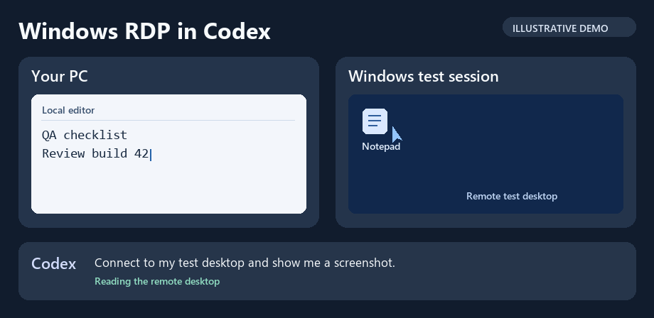

# Codex RDP Plugin for Windows

Control a Windows RDP session with Codex while you keep working on your PC. **Desktop remoto RDP** reads screenshots from the remote session and sends mouse and keyboard input over RDP. Try it for a quick UI check on a Windows VM or a legacy desktop app you maintain.

[Download v0.1.0 for Windows](https://github.com/Kad26/codex-rdp-plugin/releases/download/v0.1.0/Desktop-Remoto-RDP-v0.1.0-kad26.zip) · [Release notes](https://github.com/Kad26/codex-rdp-plugin/releases/tag/v0.1.0) · [Istruzioni in italiano](docs/installazione.it.md)



*Illustrative demo using simulated windows and sample text.*

## Requirements

- **On your PC** — Windows x64, the ChatGPT desktop app with local Codex chats, `codex.exe` on your PATH, and Python 3.13 x64 with the `py.exe` and `pyw.exe` launchers.
- **On the remote machine** — a Windows host reachable by direct RDP, such as a test VM on your network or VPN. It must accept password authentication with NLA/CredSSP and NTLM. This preview supports one RDP profile. RD Gateway, smart cards, Kerberos-only servers, and interactive MFA are outside its compatibility range.
- **Before connecting** — have a dedicated RDP account and the server's public TLS certificate (`.cer` or `.pem`) or verified SHA-256 certificate fingerprint from your administrator. RDP may reconnect an existing session if you reuse the same account.

## Get to your first screenshot

1. Download and extract the entire ZIP into a permanent folder. The installer registers the plugin from that folder.
2. Open PowerShell in the extracted folder and run:

   ```powershell
   .\Installa.ps1
   .\Configura.ps1
   ```

   `Installa.ps1` installs the hash-pinned Python dependencies and registers the local Codex plugin. `Configura.ps1` prompts for the server, verified certificate or fingerprint, and RDP credentials. Enter the password in the local prompt.
3. Reopen ChatGPT Desktop, start a **local** Codex chat, and select **Desktop remoto RDP**. Try:

   > Use Desktop remoto RDP to connect to my configured test desktop and show me a screenshot. Stop after the screenshot.

4. To test input on your test desktop, ask Codex to open Notepad, type `RDP smoke test` in a new unsaved document, and show another screenshot. Ask it to disconnect when you're done.

<details>
<summary>Verify the download</summary>

```powershell
Get-FileHash .\Desktop-Remoto-RDP-v0.1.0-kad26.zip -Algorithm SHA256
```

Expected SHA-256 `c6045d7bb39382a06f652baa4c015c17f8c2d0828e4e76c5dcde9262c3f5843d`.

</details>

## Session and data

The plugin runs locally and verifies the configured TLS fingerprint before signing in. The saved profile is encrypted with Windows DPAPI for your Windows user. Requested screenshots show the whole remote session and are sent to the chat. Remote actions run with the permissions of the configured RDP account. Use a dedicated session with test data.

Ask Codex to disconnect to close the RDP connection. Run `.\Configura.ps1 -Disattiva` in PowerShell to remove the saved profile and end an active connection.

## Source and feedback

Review the [installer](Installa.ps1), [profile setup](Configura.ps1), [MCP server and plugin manifest](plugins/desktop-remoto), and [pinned dependencies](requirements.lock) before running the preview. The project code uses the [MIT License](LICENSE). Dependencies retain their own licenses.

Trying this on your own RDP test machine? Share whether you reached the first screenshot and whether typing worked. Include Windows versions and the step that failed, using sample data or redacted errors. [Report your test results](https://github.com/Kad26/codex-rdp-plugin/issues/new?title=RDP%20preview%20test%20report)
